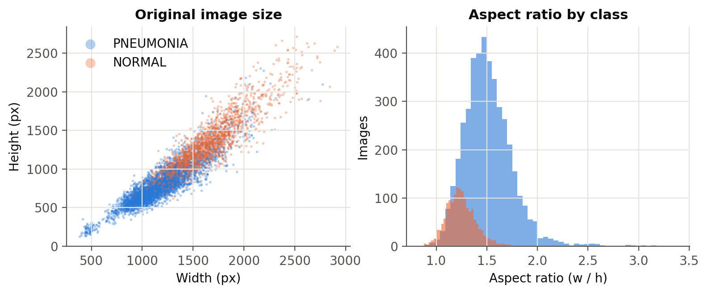

# Pneumonia detection from chest X-rays — tuned for recall, audited with Grad-CAM

**A DenseNet121 fine-tuned to flag pneumonia on paediatric chest radiographs at a triage operating point (recall ≥ 0.98), with every score read against an always-PNEUMONIA baseline and Grad-CAM used to check *where* the model looks.**

[](https://github.com/marselaneziraj/pneumonia-detection-xray/actions/workflows/ci.yml)
 

> ⚠️ **Research / portfolio project. Not a medical device, not validated for clinical use, not a diagnostic aid.**


## Headline (held-out official test split, scored once)

<!-- AUTO:headline -->
**densenet121**, threshold 0.273 chosen on val for recall >= 0.98: test recall **0.995** [0.987, 1.000] at specificity **0.765** [0.709, 0.816] - missed **2 of 390** pneumonia cases, **55 false alarms** on 234 normal films. The always-PNEUMONIA baseline scores recall 1.000 at specificity 0.000 (234 false alarms).
<!-- /AUTO:headline -->

<!-- AUTO:results_table -->
| Model | Threshold | Recall [95% CI] | Specificity [95% CI] | False alarms (FP) | Missed (FN) | PPV | NPV | F2 | Bal. acc. | AUROC | AUPRC |
|---|---|---|---|---|---|---|---|---|---|---|---|
| *always PNEUMONIA* (baseline) | constant | 1.000 | 0.000 | 234 | 0 | 0.625 | — | 0.893 | 0.500 | 0.500 | 0.625 |
| *always NORMAL* (baseline) | constant | 0.000 | 1.000 | 0 | 390 | — | 0.375 | 0.000 | 0.500 | 0.500 | 0.625 |
| *random score* (baseline) | val-tuned (recall>=0.98): 0.018 | 0.982 | 0.030 | 227 | 7 | 0.628 | 0.500 | 0.882 | 0.506 | 0.482 | 0.608 |
| *random score* (baseline) | default 0.5: 0.500 | 0.485 | 0.491 | 119 | 201 | 0.614 | 0.364 | 0.506 | 0.488 | 0.482 | 0.608 |
| **densenet121** | val-tuned (recall>=0.98): 0.273 | 0.995 [0.987, 1.000] | 0.765 [0.709, 0.816] | 55 | 2 | 0.876 | 0.989 | 0.969 | 0.880 | 0.972 | 0.974 |
| **densenet121** | default 0.5: 0.500 | 0.992 [0.982, 1.000] | 0.812 [0.761, 0.859] | 44 | 3 | 0.898 | 0.984 | 0.972 | 0.902 | 0.972 | 0.974 |
| **resnet18** | val-tuned (recall>=0.98): 0.528 | 0.995 [0.987, 1.000] | 0.684 [0.624, 0.744] | 74 | 2 | 0.840 | 0.988 | 0.959 | 0.839 | 0.959 | 0.963 |
| **resnet18** | default 0.5: 0.500 | 0.995 [0.987, 1.000] | 0.675 [0.615, 0.735] | 76 | 2 | 0.836 | 0.988 | 0.958 | 0.835 | 0.959 | 0.963 |
| **resnet18_scratch** | val-tuned (recall>=0.98): 0.956 | 0.995 [0.987, 1.000] | 0.483 [0.419, 0.551] | 121 | 2 | 0.762 | 0.983 | 0.938 | 0.739 | 0.930 | 0.949 |
| **resnet18_scratch** | default 0.5: 0.500 | 1.000 [1.000, 1.000] | 0.150 [0.107, 0.197] | 199 | 0 | 0.662 | 1.000 | 0.907 | 0.575 | 0.930 | 0.949 |

Test split: 624 images (390 PNEUMONIA, 234 NORMAL). NPV is undefined (—) when the model never predicts NORMAL.
<!-- /AUTO:results_table -->

**Reading the table.** Recall alone is meaningless here: the *always PNEUMONIA* row has perfect recall and zero specificity. Every model row is therefore quoted with its specificity, its false-alarm count and its missed-case count on the same line, against that baseline. The from-scratch ResNet18 row shows what ImageNet pretraining added.

**What the numbers say.**
- At the shipped threshold, DenseNet121 missed **2 of 390** pneumonias, at the price of **55 false alarms on 234 normal films** (specificity 0.765, 95% CI 0.709–0.816). The always-PNEUMONIA baseline raises 234 false alarms for the same job.
- **ImageNet pretraining roughly halved the false alarms** at the same recall: ResNet18 from scratch needs 121 (specificity 0.483), pretrained ResNet18 needs 74 (0.684), and DenseNet121 needs 55 (0.765).
- **The weak spot is the val→test gap.** On val, the same threshold gave specificity **0.996**; on test it gave **0.765**. Val is carved out of the official training pool, so it shares that pool's acquisition batches (and 39 of its normals share a patient with train; see *Known issues*). The official test folder was curated separately. So the val-tuned threshold transferred conservatively for recall (0.995 on test, above the 0.98 target), but its specificity did not transfer.
- In hindsight, the default 0.5 threshold would have done better on test (specificity 0.812, 44 false alarms, 3 misses). That was not knowable without looking at test, which is exactly why the threshold was frozen on val.

**Recall target vs. specificity** (threshold picked on val, applied once to test):

<!-- AUTO:sensitivity_table -->
| Recall target (val) | Threshold | Val recall | Val specificity | Test recall | Test specificity | Test FP | Test FN |
|---|---|---|---|---|---|---|---|
| 0.95 | 0.807 | 0.950 | 1.000 | 0.969 | 0.850 | 35 | 12 |
| 0.98 | 0.273 | 0.980 | 0.996 | 0.995 | 0.765 | 55 | 2 |
| 0.99 | 0.012 | 0.990 | 0.959 | 0.997 | 0.551 | 105 | 1 |
<!-- /AUTO:sensitivity_table -->

<p align="center">
  
  
</p>

## The problem and the trap

In triage, a false negative is a sick child sent home, while a false positive costs a radiologist's second look. So the model is tuned for **recall**. But "optimise for recall" is trivially gamed: predict PNEUMONIA for everything and recall = 1.000. This repo makes that impossible to hide:

1. The `always PNEUMONIA` baseline is a row in every results table.
2. Recall never appears without specificity and the false-alarm count beside it.
3. Imbalance is handled in the loss with `BCEWithLogitsLoss(pos_weight = n_neg / n_pos)`. The weight is **< 1** here (PNEUMONIA is the majority), which pushes the model *away* from the lazy majority answer.
4. Recall is bought back **explicitly at the decision threshold**, not by distorting the loss. On the validation split, `choose_threshold` picks the threshold with the highest specificity subject to recall ≥ `selection.target_recall` (0.98, in the YAML). That frozen threshold is then applied once to test.
5. The checkpoint is chosen by **val specificity at the recall target**, not by accuracy.

## Data

| | |
|---|---|
| Source | Kaggle [`paultimothymooney/chest-xray-pneumonia`](https://www.kaggle.com/datasets/paultimothymooney/chest-xray-pneumonia) ("Chest X-Ray Images (Pneumonia)"), from Kermany et al., *Cell* 2018, Guangzhou Women and Children's Medical Center |
| Kaggle version | Latest version available on 2026-11-04, downloaded with the command below (the version number was not logged by this run; see the dataset's Data Card) |
| Retrieved | 2026-11-04 (Colab T4 run) |
| Content | ~5.8k greyscale JPEGs, `NORMAL` / `PNEUMONIA`, paediatric patients aged 1–5 |

`pneumonia prepare` resolves the real root, so the nested `chest_xray/chest_xray` layout and any `__MACOSX` folder are handled. It also prints the per-split image and patient counts, asserts that every file decodes, records the image-size distribution, and draws the class-balance chart.

**Patient leakage** is the main methodological trap. The subject is encoded in the file name (`person8_bacteria_37.jpeg` → `person8`, `NORMAL2-IM-0222-0001.jpeg` → `NORMAL2-IM-0222`). The official `val` folder holds only 16 images, far too few to pick a threshold on. So the official train and val folders are pooled and re-split **by patient** with `StratifiedGroupKFold`. The official `test` folder stays untouched. A guard (`assert_no_patient_leakage`) raises if any `patient_id` sits in two splits. The dataset doesn't document whether person numbers are namespaced per folder, so any train/val patient whose id also appears in test is **dropped from train/val**: training shrinks rather than the test set being touched. The manifests `splits/split_{train,val,test}.csv` make a run reproducible image-for-image.

<!-- AUTO:split_table -->
| Split | NORMAL images (patients) | PNEUMONIA images (patients) | Total images | Distinct patients |
|---|---|---|---|---|
| train | 1080 (1079) | 2720 (1178) | 3800 | 2257 |
| val | 269 (269) | 706 (295) | 975 | 564 |
| test | 234 (234) | 390 (202) | 624 | 436 |

Pooled official train+val re-split by patient with `StratifiedGroupKFold` (seed 42, val fraction 0.2); official test untouched. Patient ids shared between the test folder and train/val: 170; train/val images dropped to keep the test patients unseen: 457. Unparsed file names: 144.

Metadata-only shortcut probe (logistic regression, val AUROC; 0.5 = no signal): image size only **0.9188**, border intensity only **0.7716**, both **0.9392**.
<!-- /AUTO:split_table -->


## Method

* **Input:** greyscale → 3 channels (so ImageNet weights apply), explicit resize to 224×224, ImageNet normalisation. A one-off resized PNG cache (`data/cache_224`) means the 1–2k-px JPEGs are not decoded every epoch.
* **Augmentation, kept anatomically honest:** horizontal flip (p=0.5), rotation ±7°, translation ±5%, zoom ±5%, brightness/contrast ±10%. These are the variations real acquisition produces: patient positioning and exposure. Vertical flips are excluded because no radiograph arrives upside down. Aggressive random crops are excluded too, because a 0.6× crop can cut a basal consolidation out of frame while keeping the PNEUMONIA label, which teaches the model that the label can come from nowhere. The horizontal flip is the debatable one, since it mirrors the heart. It stays in because pneumonia occurs in either lung, and because the flip moves the burnt-in "R"/"L" laterality marker, which weakens one known shortcut.
* **Models:** ImageNet-pretrained **DenseNet121** (primary; the CheXNet backbone) and **ResNet18** (cheaper comparison), each with a **single-logit** head. One logit plus `BCEWithLogitsLoss` keeps the decision threshold one explicit, tunable number.
* **Two-phase fine-tuning:** phase 1 freezes the backbone (BatchNorm statistics frozen too) and trains the head for 3 epochs at 1e-3, so the random layer doesn't wreck pretrained features. Phase 2 unfreezes everything at 1e-4 with AdamW and cosine decay (up to 12 epochs), with early stopping (patience 4) on the selection metric. Per-epoch train/val loss, AUROC, AUPRC, threshold, recall and specificity go to `runs/<name>/history.csv`.
* **Baselines:** `always PNEUMONIA`, `always NORMAL`, a random score, and **ResNet18 trained from scratch** (`configs/resnet18_scratch.yaml`).
* **Evaluation:** test-set metrics at the val-tuned threshold and at 0.5: recall, specificity, PPV, NPV, F2, balanced accuracy, AUROC, AUPRC, raw TP/FP/TN/FN. Recall and specificity (plus PPV/NPV) get 95% bootstrap CIs (2,000 class-stratified resamples). Every scoring of the test split is logged in `results/predictions/test_access_log.csv`. Re-running `evaluate` reuses the cached test predictions for an unchanged checkpoint instead of re-scoring.

<p align="center">
  
  
</p>


## Explanation audit (Grad-CAM)

Grad-CAM (Selvaraju et al., 2017) is implemented directly with a forward hook and a tensor gradient hook on the last convolutional feature map, about 40 lines in [`src/pneumonia/gradcam.py`](src/pneumonia/gradcam.py), with no extra dependency. The panel shows true positives, false negatives (lowest probability first, i.e. the confidently wrong ones), false positives and true negatives, each captioned with its probability.

**Known shortcut risks in this dataset:** the two classes came through different acquisition pipelines. A model can therefore key on image borders, collimation edges, body position, scanner text, or the bright "R" laterality letter instead of lung parenchyma. `pneumonia prepare` measures this risk *before* any CNN is trained: a logistic regression on **image size and border intensity only** (no lungs) is scored on val. Its AUROC appears under the split table above; anything well above 0.5 means a shortcut is available to the CNN.

Each sampled map is auto-flagged (peak or > 60% of mass in the outer 12% band) **and** reviewed by eye. Reviewers fill `manual_location` in `results/gradcam_audit.csv` with `lung` / `outside` / `mixed`, then run `pneumonia report`.

<!-- AUTO:gradcam_audit -->
| Case type | Maps | Auto: off-anatomy? | Auto: empty | By eye: lung | By eye: outside | By eye: mixed | By eye: empty | Not reviewed |
|---|---|---|---|---|---|---|---|---|
| True positives | 3 | 0 | 0 | 1 | 1 | 1 | 0 | 0 |
| False negatives | 2 | 2 | 0 | 0 | 2 | 0 | 0 | 0 |
| False positives | 3 | 0 | 0 | 1 | 0 | 2 | 0 | 0 |
| True negatives | 3 | 0 | 3 | 0 | 0 | 0 | 3 | 0 |
| **All** | 11 | 2 | 3 | 2 | 3 | 3 | 3 | 0 |

Auto-flag off-anatomy? = CAM peak in the outer 12% band, or >60% of CAM mass there (a spatially uniform map puts 42% there); empty = no positive PNEUMONIA evidence anywhere (expected for confident negatives). Mean border mass over the sampled maps: 0.422. Manual columns come from `results/gradcam_audit.csv`, filled by eye.
<!-- /AUTO:gradcam_audit -->

**What I see: the model is often looking at the wrong thing.** Of the 8 sampled maps with any PNEUMONIA evidence, only **2 sit on the lung fields**, 3 sit mainly outside them, and 3 are split between lung and an artefact. **4 of the 8 light up burnt-in text or the "R" laterality letter.**
- *True positives:* one map covers both lungs plausibly. The other two are hottest in the top-right corner, over the timestamp or the scanner's mA/kV text block, with lung activation secondary.
- *False negatives:* both maps are cold over the lungs, with only a spot at the bottom-right image edge. The model found no lung evidence at all; it did not merely underweight it.
- *False positives:* two of the three put a strong focus on the "R" letter. One of these also lights up the left lower zone next to the "KV58" label. The third reads a hazy, low-contrast normal film as opacity.

This agrees with two independent measurements. The metadata-only probe predicts the class from **image size alone with val AUROC 0.919** (see the split table). The image-size audit also shows that PNEUMONIA films are systematically wider than NORMAL ones (aspect ratio ≈ 1.5 vs ≈ 1.25), and the square 224×224 resize keeps that difference visible to the CNN as a squashed or unsquashed thorax.

The auto-flag heuristic caught only the 2 false negatives and missed all 4 text/letter cases, because those hot spots sit at about 79% of the width: near the corner, but just outside the outer 12% band it checks. The heuristic is too weak and the by-eye column is the one to trust. Caveats: 11 maps is a small sample, selected as the most confident cases; Grad-CAM here is 7×7 upsampled; and saliency is not proof of what drives the decision. Still, the evidence points one way: **part of this model's score comes from acquisition artefacts, not parenchyma.**



Note that a confidently negative case often gets a near-empty map, because Grad-CAM explains the PNEUMONIA logit and ReLU removes negative evidence. A blank TN map is expected behaviour, not a bug.

## Error analysis

<!-- AUTO:error_analysis -->
- False negatives: **2 of 390** test pneumonias. Subtypes among misses: {'bacteria': 1, 'virus': 1} (all positives: {'bacteria': 242, 'virus': 148}).
- Miss rate by subtype: bacteria 0.004, virus 0.007. Viral share among misses 0.500 vs 0.379 among all positives.
- Exposure: mean pixel intensity of misses 0.493 vs 0.467 for true positives; contrast (pixel std) 0.216 vs 0.219.
- Lowest-scored misses (the confidently wrong ones): [0.0016, 0.1868]. Full list: `results/false_negatives.csv`.
<!-- /AUTO:error_analysis -->

## Reproduce

Step-by-step for VS Code (Windows/macOS/Linux) and GitHub publication: [`docs/RUN_IN_VSCODE_AND_PUBLISH.md`](docs/RUN_IN_VSCODE_AND_PUBLISH.md). Requires Python 3.10–3.13. A free Colab T4 runs all three models in well under an hour ([`notebooks/colab_gpu_run.ipynb`](notebooks/colab_gpu_run.ipynb)). The CPU smoke mode exercises the whole path on a laptop or in CI.

```bash
git clone https://github.com/marselaneziraj/pneumonia-detection-xray.git
cd pneumonia-detection-xray
python -m venv .venv && source .venv/bin/activate      # Windows: .venv\Scripts\activate
pip install -e ".[dev,data]"
```

```bash
# Kaggle token: kaggle.com -> Settings -> API -> Create New Token -> ~/.kaggle/kaggle.json
kaggle datasets download -d paultimothymooney/chest-xray-pneumonia -p data --unzip
```

```bash
pneumonia prepare  --config configs/densenet121.yaml   # index, audit, grouped split, cache
pneumonia train    --config configs/densenet121.yaml   # primary
pneumonia train    --config configs/resnet18.yaml      # cheaper comparison
pneumonia train    --config configs/resnet18_scratch.yaml  # from-scratch baseline
pneumonia evaluate                                     # scores test once; results.csv, metrics.json, figures
pneumonia gradcam  --per-case 3                        # Grad-CAM panel + audit sheet
pneumonia report                                       # writes the numbers into README/report/model card
```

Smoke test without the dataset or a GPU (writes only to `*_smoke/` folders):

```bash
pneumonia make-synthetic --out data_synthetic && pneumonia prepare --config configs/smoke.yaml && pneumonia train --config configs/smoke.yaml --limit-train-batches 3 && pneumonia evaluate --configs configs/smoke.yaml && pneumonia gradcam --config configs/smoke.yaml --per-case 2
```

Tests and lint (offline, CPU, no dataset): `pytest` and `ruff check src tests`.

The trained weights (`runs/*/best.pt`) are **not committed**; the commands above regenerate them. The seed (42) and all hyperparameters live in `configs/*.yaml`. Library versions are written next to the results in `results/metrics.json`:

<!-- AUTO:versions -->
Generated 2026-11-04T21:56:50Z (git a4bb440), seed 42; python 3.13.16, torch 2.11.0+cu130, torchvision 0.26.0+cu130, numpy 2.4.6, scikit-learn 1.6.1; GPU Tesla T4.
<!-- /AUTO:versions -->

### Repository layout

```
configs/            one YAML per architecture (+ smoke.yaml); every hyperparameter + target_recall
src/pneumonia/      indexing, data, model, train, evaluate, gradcam, metrics, plots, report, cli
splits/             patient-grouped manifests split_{train,val,test}.csv + split_summary.json
results/            results.csv, metrics.json, gradcam_audit.csv, figures/*.png (committed)
docs/model_card.md  intended use, data, operating point, performance with CIs, limitations
report.md           1-2 page write-up
tests/              pytest, offline (synthetic 20-image tree, random-init models)
```

## Known issues in this run

* **Patient-ID parser bug (fixed after this run).** Version 0.1.0 of `parse_filename` did not recognise names with an extra suffix: `IM-0429-0001-0002.jpeg`, `NORMAL2-IM-…-0001-0001.jpeg`, and one `person…_virus_…_1.jpeg`. Those 144 images (143 NORMAL, 1 PNEUMONIA) were each treated as a separate patient. Re-checking the shipped manifests with the fixed parser: **0 test images share a patient with train/val, so the test numbers above stand.** However, 33 patients (60 train / 39 val NORMAL images) straddle train and val. That makes the val numbers, the val-tuned threshold and the checkpoint selection slightly optimistic. The parser is fixed and covered by tests; re-running the Colab notebook regenerates every number without the leak.
* **Test/train overlap of patient IDs.** 170 patient IDs from the official test folder also appear in the official training folder. Whether that is the same child or a per-folder numbering coincidence is undocumented, so the 457 train/val images with those IDs were dropped from training (the conservative choice). The test folder was not touched.

## Limitations (read these)

* **Acquisition shortcuts are present and used.** Image size alone separates the classes (val AUROC 0.919), and half of the sampled Grad-CAM maps light up text or laterality markers. The test score therefore overstates how well the model reads lungs.
* **Paediatric, single-centre.** All films come from one Guangzhou hospital, patients aged 1–5. Nothing here transfers to adult chest films, or to another hospital's scanners, without revalidation.
* **Labels** come from the original curation (expert graders, with a third grader for the test set as described by Kermany et al.), not from a fresh consensus read. Some label noise is known to exist.
* **The test split is about 624 images from the same centre.** The scores are an optimistic upper bound on real-world performance; read the CIs, not the point estimates.
* **Grad-CAM is a saliency heuristic**: coarse (7×7 for both backbones at 224 px), not a segmentation, and not evidence of clinical reasoning.
* **Not a medical device.** This is a portfolio/research project, not validated for clinical use, and not a diagnostic aid.

## What I'd do with more time

* **Remove the shortcuts, then re-measure.** Use an aspect-preserving resize (letterbox/pad instead of squash), mask or crop burnt-in text and the laterality letter, and train on lung-field crops. Then rerun the shortcut probe and the Grad-CAM audit: the honest target is a model whose specificity survives without those cues.
* Choose the threshold on a split that looks like deployment. The val→test specificity drop (0.996 → 0.765) says val is too easy. Repeated grouped CV, or holding out an acquisition batch, would give a less optimistic operating point.
* External validation on adult films and another centre (e.g. a few hundred films from a public adult dataset) to *measure* the domain shift instead of asserting it.
* Lung-field segmentation masks, so the Grad-CAM audit reports "% of CAM mass inside the lungs" instead of a border heuristic. Also train on lung-cropped inputs to remove border shortcuts outright.
* Calibration (temperature scaling, reliability curve, Brier score), so the 0.98-recall threshold sits on probabilities that mean something.
* Patient-level aggregation and repeated grouped CV (5 seeds × 5 folds) for threshold selection, to reduce the variance of a single val split.
* Bacterial-vs-viral second head (the labels are in the file names) and a TTA/ensemble check of whether recall at fixed specificity actually improves.

## Licence

MIT. See [LICENSE](LICENSE). The dataset is distributed by its authors under its own licence (CC BY 4.0 on Mendeley Data) and is **not** included here.
