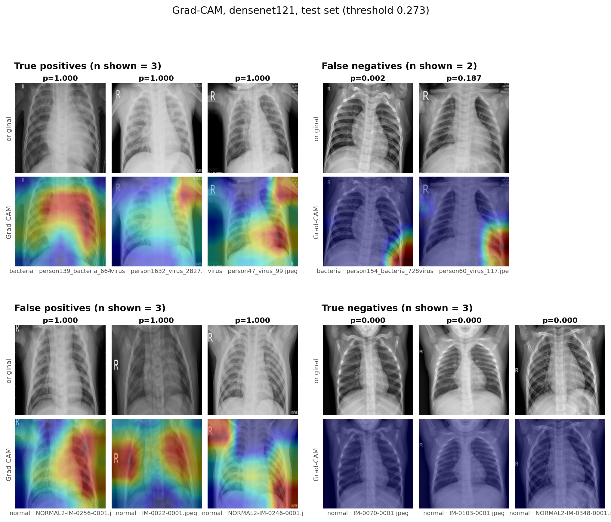
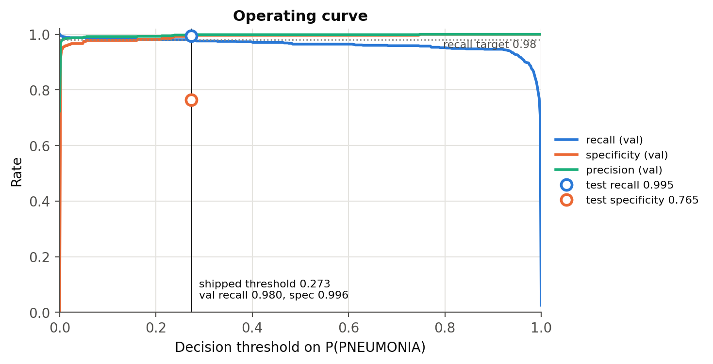
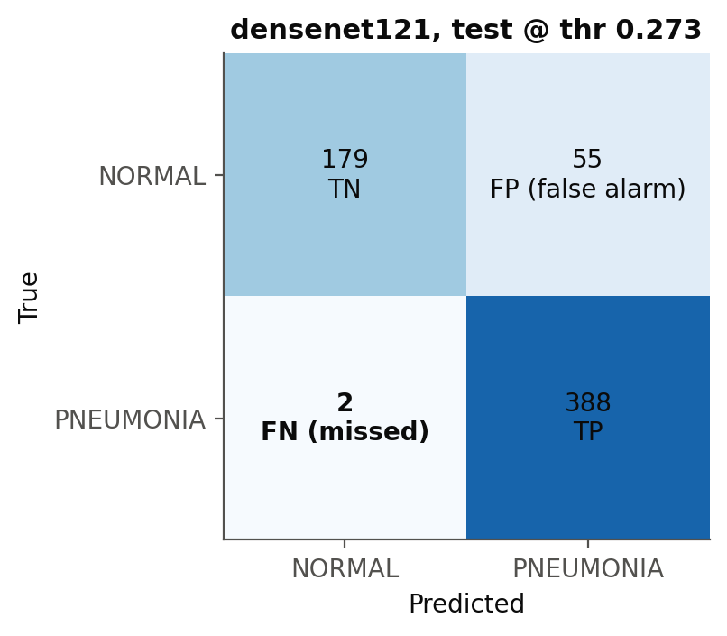
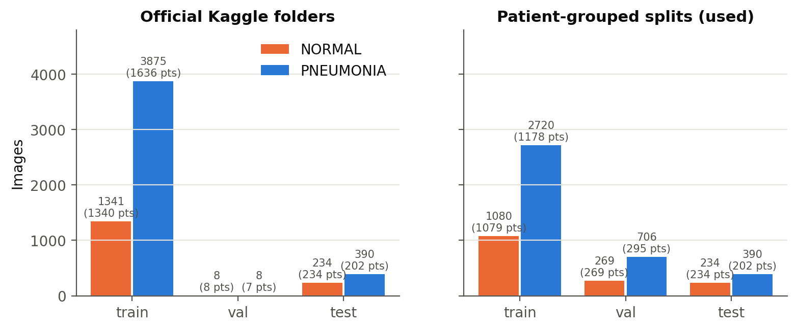
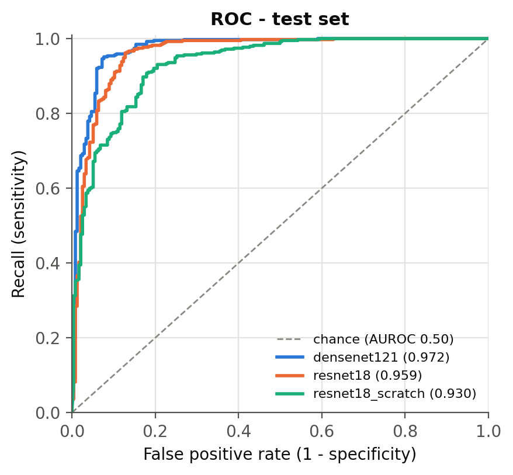
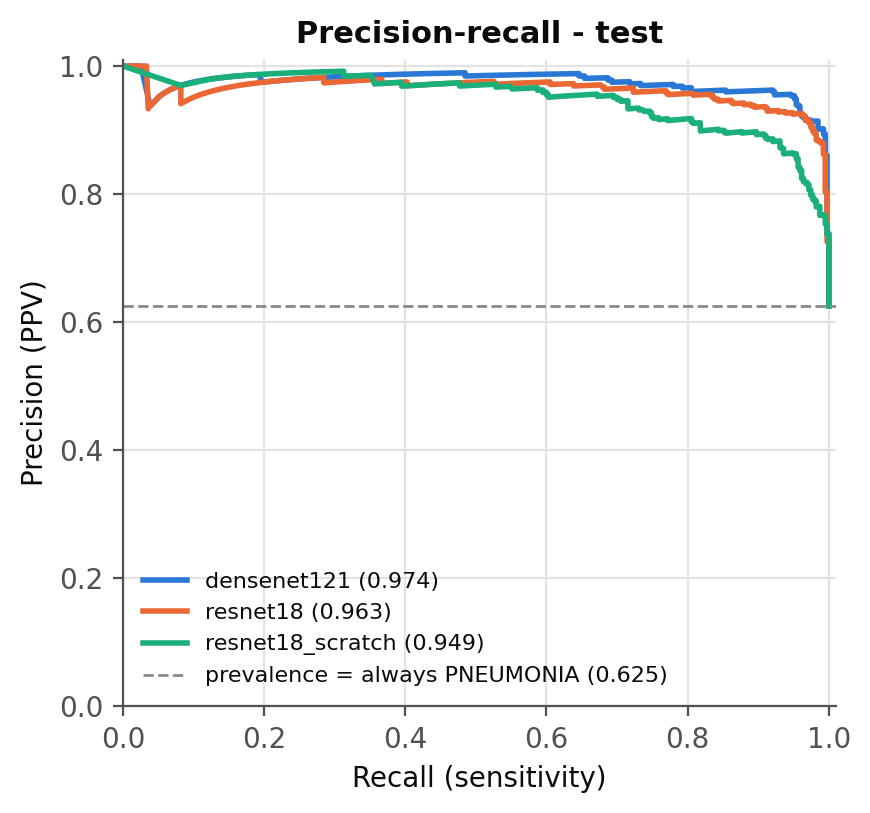
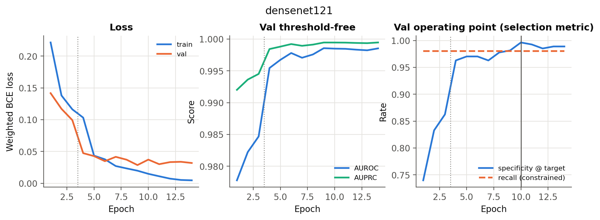
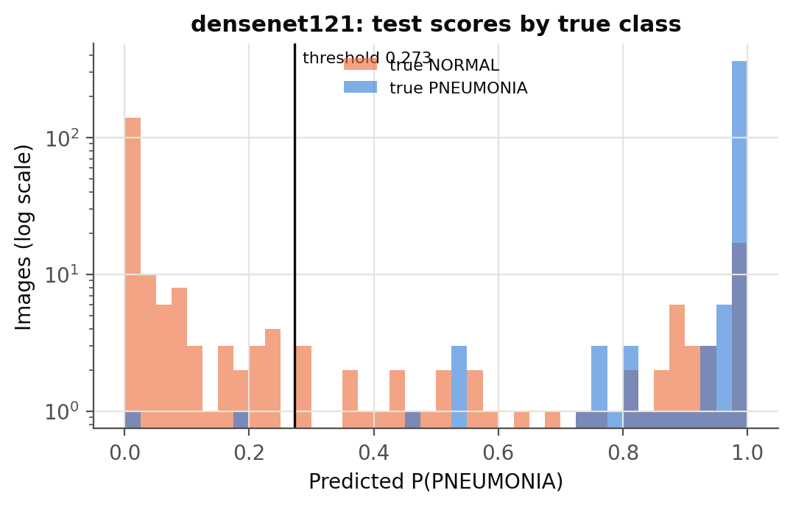

# Pneumonia detection from chest X-rays — tuned for recall, audited with Grad-CAM

**A DenseNet121 fine-tuned to flag pneumonia on paediatric chest radiographs at a triage operating point (recall ≥ 0.98), with every score read against an always-PNEUMONIA baseline and Grad-CAM used to check *where* the model looks.**

[](https://github.com/marselaneziraj/pneumonia-detection-xray/actions/workflows/ci.yml)
 

> ⚠️ **Research / portfolio project. Not a medical device, not validated for clinical use, not a diagnostic aid.**



## Headline (held-out official test split, scored once)

<!-- AUTO:headline -->
_Headline pending: no trained checkpoint was evaluated yet._
<!-- /AUTO:headline -->

<!-- AUTO:results_table -->
| Model | Threshold | Recall [95% CI] | Specificity [95% CI] | False alarms (FP) | Missed (FN) | PPV | NPV | F2 | Bal. acc. | AUROC | AUPRC |
|---|---|---|---|---|---|---|---|---|---|---|---|
| **densenet121** ¹ | val-tuned (recall>=0.98) | — | — | — | — | — | — | — | — | — | — |
| **densenet121** ¹ | default 0.5 | — | — | — | — | — | — | — | — | — | — |
| **resnet18** ¹ | val-tuned (recall>=0.98) | — | — | — | — | — | — | — | — | — | — |
| **resnet18** ¹ | default 0.5 | — | — | — | — | — | — | — | — | — | — |
| **resnet18_scratch** ¹ | val-tuned (recall>=0.98) | — | — | — | — | — | — | — | — | — | — |
| **resnet18_scratch** ¹ | default 0.5 | — | — | — | — | — | — | — | — | — | — |
| *always PNEUMONIA* (baseline) | constant | 1.000 by construction | 0.000 by construction | all normals | 0 | prevalence | — | — | 0.500 | 0.500 | prevalence |
| *always NORMAL* (baseline) | constant | 0.000 | 1.000 | 0 | all positives | — | — | 0.000 | 0.500 | 0.500 | prevalence |
| *random score* (baseline) ¹ | val-tuned / 0.5 | — | — | — | — | — | — | — | — | — | — |

¹ Not run yet: the authoring environment had no access to Kaggle (dataset) or download.pytorch.org (ImageNet weights) and no GPU. Every blank fills itself when you run the pipeline below and then `pneumonia report`; nothing here is estimated.
<!-- /AUTO:results_table -->

**Reading the table.** Recall alone is meaningless here: the *always PNEUMONIA* row has perfect recall and zero specificity. Every model row is therefore quoted with its specificity, its false-alarm count and its missed-case count on the same line, against that baseline. The from-scratch ResNet18 row shows what ImageNet pretraining added.

**Recall target vs. specificity** (threshold picked on val, applied once to test):

<!-- AUTO:sensitivity_table -->
_densenet121 not evaluated yet - run `pneumonia train` and `pneumonia evaluate`._
<!-- /AUTO:sensitivity_table -->

<p align="center">
  
  
</p>

## The problem and the trap

In triage, a false negative is a sick child sent home, while a false positive costs a radiologist's second look. So the model is tuned for **recall**. But "optimise for recall" is trivially gamed: predict PNEUMONIA for everything and recall = 1.000. This repo makes that impossible to hide:

1. The `always PNEUMONIA` baseline is a row in every results table.
2. Recall never appears without specificity and the false-alarm count beside it.
3. Imbalance is handled in the loss with `BCEWithLogitsLoss(pos_weight = n_neg / n_pos)`. The weight is **< 1** here (PNEUMONIA is the majority), which pushes the model *away* from the lazy majority answer.
4. Recall is bought back **explicitly at the decision threshold**, not by distorting the loss. On the validation split, `choose_threshold` picks the threshold with the highest specificity subject to recall ≥ `selection.target_recall` (0.98, in the YAML). That frozen threshold is then applied once to test.
5. The checkpoint is chosen by **val specificity at the recall target**, not by accuracy.

## Data

| | |
|---|---|
| Source | Kaggle [`paultimothymooney/chest-xray-pneumonia`](https://www.kaggle.com/datasets/paultimothymooney/chest-xray-pneumonia) ("Chest X-Ray Images (Pneumonia)"), from Kermany et al., *Cell* 2018, Guangzhou Women and Children's Medical Center |
| Kaggle version | **vN — fill in** (shown on the dataset page / `kaggle datasets metadata`) |
| Retrieved | **YYYY-MM-DD — fill in** |
| Content | ~5.8k greyscale JPEGs, `NORMAL` / `PNEUMONIA`, paediatric patients aged 1–5 |

`pneumonia prepare` resolves the real root, so the nested `chest_xray/chest_xray` layout and any `__MACOSX` folder are handled. It also prints the per-split image and patient counts, asserts that every file decodes, records the image-size distribution, and draws the class-balance chart.

**Patient leakage** is the main methodological trap. The subject is encoded in the file name (`person8_bacteria_37.jpeg` → `person8`, `NORMAL2-IM-0222-0001.jpeg` → `NORMAL2-IM-0222`). The official `val` folder holds only 16 images, far too few to pick a threshold on. So the official train and val folders are pooled and re-split **by patient** with `StratifiedGroupKFold`. The official `test` folder stays untouched. A guard (`assert_no_patient_leakage`) raises if any `patient_id` sits in two splits. The dataset doesn't document whether person numbers are namespaced per folder, so any train/val patient whose id also appears in test is **dropped from train/val**: training shrinks rather than the test set being touched. The manifests `splits/split_{train,val,test}.csv` make a run reproducible image-for-image.

<!-- AUTO:split_table -->
_Run `pneumonia prepare` to generate the split table._
<!-- /AUTO:split_table -->



## Method

* **Input:** greyscale → 3 channels (so ImageNet weights apply), explicit resize to 224×224, ImageNet normalisation. A one-off resized PNG cache (`data/cache_224`) means the 1–2k-px JPEGs are not decoded every epoch.
* **Augmentation, kept anatomically honest:** horizontal flip (p=0.5), rotation ±7°, translation ±5%, zoom ±5%, brightness/contrast ±10%. These are the variations real acquisition produces: patient positioning and exposure. Vertical flips are excluded because no radiograph arrives upside down. Aggressive random crops are excluded too, because a 0.6× crop can cut a basal consolidation out of frame while keeping the PNEUMONIA label, which teaches the model that the label can come from nowhere. The horizontal flip is the debatable one, since it mirrors the heart. It stays in because pneumonia occurs in either lung, and because the flip moves the burnt-in "R"/"L" laterality marker, which weakens one known shortcut.
* **Models:** ImageNet-pretrained **DenseNet121** (primary; the CheXNet backbone) and **ResNet18** (cheaper comparison), each with a **single-logit** head. One logit plus `BCEWithLogitsLoss` keeps the decision threshold one explicit, tunable number.
* **Two-phase fine-tuning:** phase 1 freezes the backbone (BatchNorm statistics frozen too) and trains the head for 3 epochs at 1e-3, so the random layer doesn't wreck pretrained features. Phase 2 unfreezes everything at 1e-4 with AdamW and cosine decay (up to 12 epochs), with early stopping (patience 4) on the selection metric. Per-epoch train/val loss, AUROC, AUPRC, threshold, recall and specificity go to `runs/<name>/history.csv`.
* **Baselines:** `always PNEUMONIA`, `always NORMAL`, a random score, and **ResNet18 trained from scratch** (`configs/resnet18_scratch.yaml`).
* **Evaluation:** test-set metrics at the val-tuned threshold and at 0.5: recall, specificity, PPV, NPV, F2, balanced accuracy, AUROC, AUPRC, raw TP/FP/TN/FN. Recall and specificity (plus PPV/NPV) get 95% bootstrap CIs (2,000 class-stratified resamples). Every scoring of the test split is logged in `results/predictions/test_access_log.csv`. Re-running `evaluate` reuses the cached test predictions for an unchanged checkpoint instead of re-scoring.

<p align="center">
  
  
</p>




## Explanation audit (Grad-CAM)

Grad-CAM (Selvaraju et al., 2017) is implemented directly with a forward hook and a tensor gradient hook on the last convolutional feature map, about 40 lines in [`src/pneumonia/gradcam.py`](src/pneumonia/gradcam.py), with no extra dependency. The panel shows true positives, false negatives (lowest probability first, i.e. the confidently wrong ones), false positives and true negatives, each captioned with its probability.

**Known shortcut risks in this dataset:** the two classes came through different acquisition pipelines. A model can therefore key on image borders, collimation edges, body position, scanner text, or the bright "R" laterality letter instead of lung parenchyma. `pneumonia prepare` measures this risk *before* any CNN is trained: a logistic regression on **image size and border intensity only** (no lungs) is scored on val. Its AUROC appears under the split table above; anything well above 0.5 means a shortcut is available to the CNN.

Each sampled map is auto-flagged (peak or > 60% of mass in the outer 12% band) **and** reviewed by eye. Reviewers fill `manual_location` in `results/gradcam_audit.csv` with `lung` / `outside` / `mixed`, then run `pneumonia report`.

<!-- AUTO:gradcam_audit -->
_Run `pneumonia gradcam --per-case 3` to produce the panel and audit sheet._
<!-- /AUTO:gradcam_audit -->

**What I see:** _fill in after viewing the panel. For each case type, say whether the activation sits in the lung fields or outside them, and name any off-anatomy cue (laterality letter, collimation edge, arms, text). If the model is looking at the wrong thing, say so; that is the finding._ Note that a confidently negative case often gets a near-empty map, because Grad-CAM explains the PNEUMONIA logit and ReLU removes negative evidence. A blank TN map is expected behaviour, not a bug.

## Error analysis

<!-- AUTO:error_analysis -->
_Pending evaluation._
<!-- /AUTO:error_analysis -->

## Reproduce

Step-by-step for VS Code (Windows/macOS/Linux) and GitHub publication: [`docs/RUN_IN_VSCODE_AND_PUBLISH.md`](docs/RUN_IN_VSCODE_AND_PUBLISH.md). Requires Python 3.10–3.13. A free Colab T4 runs all three models in well under an hour ([`notebooks/colab_gpu_run.ipynb`](notebooks/colab_gpu_run.ipynb)). The CPU smoke mode exercises the whole path on a laptop or in CI.

```bash
git clone https://github.com/marselaneziraj/pneumonia-detection-xray.git
cd pneumonia-detection-xray
python -m venv .venv && source .venv/bin/activate      # Windows: .venv\Scripts\activate
pip install -e ".[dev,data]"
```

```bash
# Kaggle token: kaggle.com -> Settings -> API -> Create New Token -> ~/.kaggle/kaggle.json
kaggle datasets download -d paultimothymooney/chest-xray-pneumonia -p data --unzip
```

```bash
pneumonia prepare  --config configs/densenet121.yaml   # index, audit, grouped split, cache
pneumonia train    --config configs/densenet121.yaml   # primary
pneumonia train    --config configs/resnet18.yaml      # cheaper comparison
pneumonia train    --config configs/resnet18_scratch.yaml  # from-scratch baseline
pneumonia evaluate                                     # scores test once; results.csv, metrics.json, figures
pneumonia gradcam  --per-case 3                        # Grad-CAM panel + audit sheet
pneumonia report                                       # writes the numbers into README/report/model card
```

Smoke test without the dataset or a GPU (writes only to `*_smoke/` folders):

```bash
pneumonia make-synthetic --out data_synthetic && pneumonia prepare --config configs/smoke.yaml && pneumonia train --config configs/smoke.yaml --limit-train-batches 3 && pneumonia evaluate --configs configs/smoke.yaml && pneumonia gradcam --config configs/smoke.yaml --per-case 2
```

Tests and lint (offline, CPU, no dataset): `pytest` and `ruff check src tests`.

The trained weights (`runs/*/best.pt`) are **not committed**; the commands above regenerate them. The seed (42) and all hyperparameters live in `configs/*.yaml`. Library versions are written next to the results in `results/metrics.json`:

<!-- AUTO:versions -->
_Pending evaluation._
<!-- /AUTO:versions -->

### Repository layout

```
configs/            one YAML per architecture (+ smoke.yaml); every hyperparameter + target_recall
src/pneumonia/      indexing, data, model, train, evaluate, gradcam, metrics, plots, report, cli
splits/             patient-grouped manifests split_{train,val,test}.csv + split_summary.json
results/            results.csv, metrics.json, gradcam_audit.csv, figures/*.png (committed)
docs/model_card.md  intended use, data, operating point, performance with CIs, limitations
report.md           1-2 page write-up
tests/              pytest, offline (synthetic 20-image tree, random-init models)
```

## Limitations (read these)

* **Paediatric, single-centre.** All films come from one Guangzhou hospital, patients aged 1–5. Nothing here transfers to adult chest films, or to another hospital's scanners, without revalidation.
* **Labels** come from the original curation (expert graders, with a third grader for the test set as described by Kermany et al.), not from a fresh consensus read. Some label noise is known to exist.
* **The test split is about 624 images from the same centre.** The scores are an optimistic upper bound on real-world performance; read the CIs, not the point estimates.
* **Grad-CAM is a saliency heuristic**: coarse (7×7 for both backbones at 224 px), not a segmentation, and not evidence of clinical reasoning.
* **Not a medical device.** This is a portfolio/research project, not validated for clinical use, and not a diagnostic aid.

## What I'd do with more time

* External validation on adult films and another centre (e.g. a few hundred films from a public adult dataset) to *measure* the domain shift instead of asserting it.
* Lung-field segmentation masks, so the Grad-CAM audit reports "% of CAM mass inside the lungs" instead of a border heuristic. Also train on lung-cropped inputs to remove border shortcuts outright.
* Calibration (temperature scaling, reliability curve, Brier score), so the 0.98-recall threshold sits on probabilities that mean something.
* Patient-level aggregation and repeated grouped CV (5 seeds × 5 folds) for threshold selection, to reduce the variance of a single val split.
* Bacterial-vs-viral second head (the labels are in the file names) and a TTA/ensemble check of whether recall at fixed specificity actually improves.

## Licence

MIT. See [LICENSE](LICENSE). The dataset is distributed by its authors under its own licence (CC BY 4.0 on Mendeley Data) and is **not** included here.
