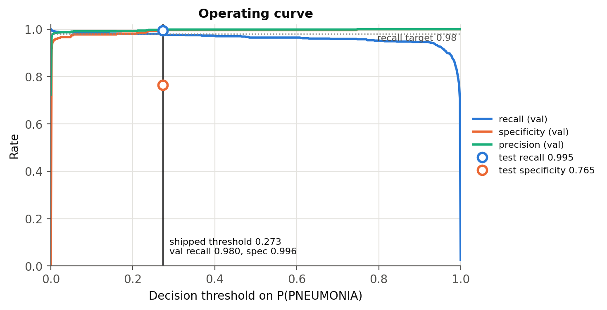
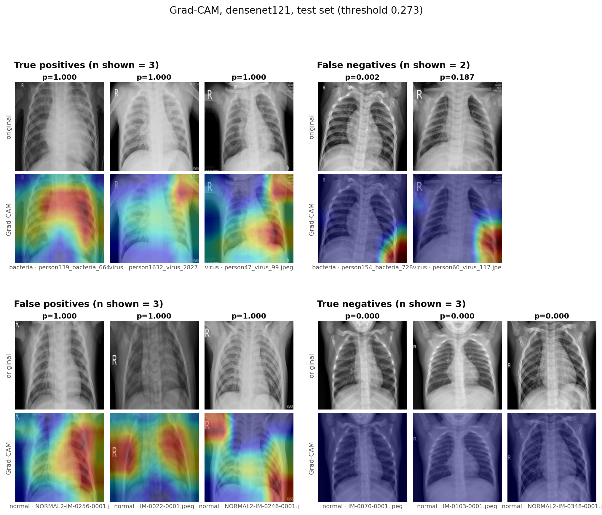
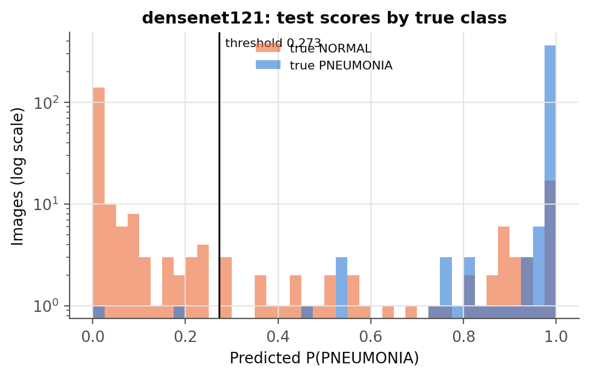

# Recall-tuned pneumonia detection on paediatric chest X-rays — short report

*Research/portfolio project, not a medical device. All numbers below are generated by `pneumonia report` from `results/results.csv` and `results/metrics.json`.*

## 1. Question

Can an ImageNet-pretrained CNN flag pneumonia at a **triage operating point**, with recall ≥ 0.98 and as much specificity as that allows, under **patient-grouped** splits? And does it do so by looking at the lungs rather than at acquisition artefacts?

## 2. Setup in one paragraph

Kaggle `paultimothymooney/chest-xray-pneumonia` (Kermany et al.). The official train+val folders are pooled and re-split by patient (`StratifiedGroupKFold`, 80/20, seed 42); the official test folder is held out and scored once. Models: DenseNet121 (primary) and ResNet18, both ImageNet-pretrained, plus a ResNet18 trained from scratch, each with a single logit. Training uses `BCEWithLogitsLoss(pos_weight = n_neg/n_pos < 1)` and two-phase fine-tuning (frozen backbone for 3 epochs, then full fine-tuning with AdamW and cosine decay, early stopping). The checkpoint is selected by val specificity at recall ≥ 0.98, and the threshold is chosen on val as max specificity subject to recall ≥ 0.98, then frozen.

<!-- AUTO:split_table -->
_Run `pneumonia prepare` to generate the split table._
<!-- /AUTO:split_table -->

## 3. Results (test, n ≈ 624)

<!-- AUTO:headline -->
_Headline pending: no trained checkpoint was evaluated yet._
<!-- /AUTO:headline -->

<!-- AUTO:results_table -->
_Pending: run the pipeline, then `pneumonia report`._
<!-- /AUTO:results_table -->

Sensitivity of the operating point to the recall target:

<!-- AUTO:sensitivity_table -->
_Pending._
<!-- /AUTO:sensitivity_table -->

**Interpretation (fill in from the numbers above):** (a) how much specificity the 0.98 target costs relative to the 0.95 target; (b) whether test recall held at the val-tuned threshold, or slipped below 0.98, and whether the CI's lower bound is under the target; (c) how far the pretrained models sit above the from-scratch ResNet18 at the same recall; (d) the NPV, i.e. what a NEGATIVE call means at this prevalence. If specificity collapses at 0.98, give the number here and say so.

## 4. Explanation audit

<!-- AUTO:gradcam_audit -->
_Pending._
<!-- /AUTO:gradcam_audit -->

**Observed (fill in after looking):**

* *True positives:* where is the activation? Inside the lung fields (which lobe), or on the mediastinum, diaphragm or edges?
* *False negatives:* is the map empty (the model saw no evidence), or does it sit on the right region with too little weight?
* *False positives:* what drove the alarm? Lung markings, or a border, letter or arm?
* *True negatives:* weak or empty maps are expected (see README).
* **Count:** __ of __ sampled maps are off-anatomy by eye, versus __ auto-flagged.

The metadata-only shortcut probe (section 2 table) says how much class signal sits outside the lungs at all.

## 5. Error analysis

<!-- AUTO:error_analysis -->
_Pending._
<!-- /AUTO:error_analysis -->

**Are the misses early/subtle, viral, or poorly exposed?** Answer from the subtype miss rates and the exposure statistics above, and from opening `results/false_negatives.csv`.

**Next:** external adult/multi-centre validation; lung-mask-based CAM scoring, and training on lung crops to remove border shortcuts; calibration; repeated grouped CV for threshold selection.

## 6. Resume line (auto-filled)

<!-- AUTO:resume -->
_Fill after the run: recall [X]% at specificity [Y]%._
<!-- /AUTO:resume -->

<!-- AUTO:versions -->
_Pending._
<!-- /AUTO:versions -->
